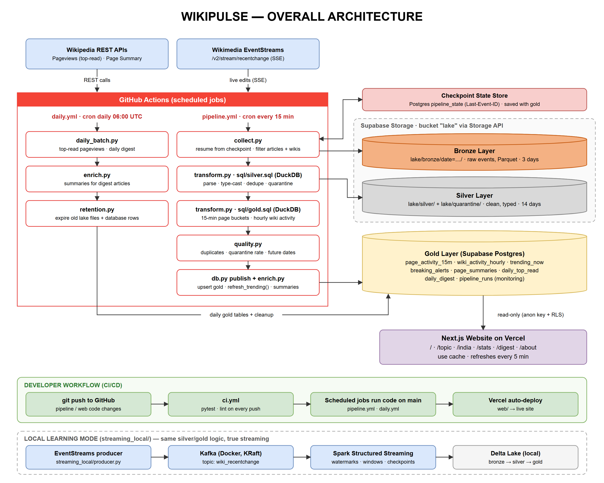

# WikiPulse: Wikipedia Live Edit Analytics

**Live site: [thewikipulse.vercel.app](https://thewikipulse.vercel.app)**

**What is the world paying attention to right now?** WikiPulse turns the live stream of Wikipedia
edits into trending topics, breaking-news spikes and language-wise activity for English and ten
Indian-language Wikipedias, served on a website.

When something big happens, Wikipedia editors update the article within minutes, often before
full news coverage exists. WikiPulse makes that signal visible.



## What it does

| Page | Shows |
|---|---|
| **Pulse** (`/`) | Articles with the most people editing them in the last half hour, breaking alerts, yesterday's most-read articles |
| **Topic** (`/topic/<wiki>/<title>`) | Hourly edit timeline (human vs bot), editors, size change, most-read rank, alert history |
| **India** (`/india`) | Trending per Indian language, activity by hour of day (IST), a 7-day growth leaderboard |
| **Stats** (`/stats`) | Bot and anonymous share, weekly rhythm heatmap, per-wiki totals |
| **Digest** (`/digest/<date>`) | The most-edited articles of each day |

## How it works

A medallion lakehouse:

| Layer | Where | Contents | Kept for |
|---|---|---|---|
| Bronze | Supabase Storage (`lake/bronze/date=…/`) | Raw events as received, Parquet | 3 days |
| Silver | Supabase Storage (`lake/silver/`, `lake/quarantine/`) | Parsed, typed, deduplicated; bad rows quarantined | 14 days |
| Gold | Supabase Postgres | Tables the website reads | see `pipeline/retention.py` |

**Every 15 minutes** (`.github/workflows/pipeline.yml`):

1. `collect.py` reconnects to [Wikimedia EventStreams](https://stream.wikimedia.org/?doc) and
   **resumes from the saved `Last-Event-ID`**, so no edit is missed or read twice between runs. It
   reads until it reaches the live edge of the stream and keeps article edits from the 11 tracked wikis.
2. `transform.py` + `sql/silver.sql` (DuckDB): parse JSON, cast types, flag bots and anonymous
   editors, dedupe on `event_id`, quarantine malformed rows.
3. `sql/gold.sql`: roll up into 15-minute article buckets and hourly wiki totals.
4. `quality.py`: duplicate, quarantine-rate and timestamp checks. **A failed check stops the run
   before anything is published**; the checkpoint does not move, so the next run retries.
5. Parquet files go to the lake, then `db.py` merges gold rows, recomputes trending
   (`refresh_trending()` in SQL) and advances the checkpoint **in one transaction**.
6. `enrich.py` fetches descriptions and thumbnails for trending articles.

**Daily** (`.github/workflows/daily.yml`): most-read articles from the Pageviews API, the daily
digest, summaries, and retention cleanup that keeps storage bounded.

**Trending and breaking.** Articles are ranked by the number of distinct human editors in the
last 15–30 minutes. An article is *breaking* when it has 8 or more human edits from 3 or more
editors, at 5× or more its average rate over the previous 24 hours.

**Website.** Next.js 16 with Cache Components: pages are pre-rendered and refreshed in the
background every 5 minutes, so traffic barely touches the database. It reads gold tables with the
publishable key; Row Level Security allows read-only access to gold tables only.

### Local learning mode: Kafka + Spark Structured Streaming

`streaming_local/` runs the same pipeline as a true stream, using the same rules
(`pipeline/rules.py`): EventStreams → Kafka (KRaft, Docker) → Spark Structured Streaming → Delta
Lake, with watermarks, dedup within a watermark, tumbling and sliding windows, and checkpoints.
See [streaming_local/README.md](streaming_local/README.md).

## Tech stack

Python · DuckDB · Parquet · Supabase (Postgres + Storage via S3 API) · GitHub Actions ·
Next.js 16 · React 19 · Tailwind CSS 4 · Vercel · Apache Kafka · Spark Structured Streaming ·
Delta Lake · Docker

## Repository layout

```
pipeline/            batch micro-pipeline (collect, transform, quality, publish, daily, retention)
  sql/               DuckDB SQL for silver and gold
supabase/            Supabase CLI project: migrations (gold schema, RLS, storage bucket)
web/                 Next.js website
streaming_local/     Kafka + Spark Structured Streaming learning mode (Docker)
tests/               pytest suite (no network or database needed)
docs/architecture/   diagram and the script that draws it
.github/workflows/   ci.yml, pipeline.yml (every 15 min), daily.yml
```

## Setup

### 1. Supabase

```bash
npx supabase login
npx supabase link --project-ref <project-ref>
npx supabase db push          # creates gold tables, RLS policies and the "lake" bucket
```

Everything else comes from the CLI too:

- **Postgres URL:** `supabase/.temp/pooler-url` (written by `link`; add your database password).
- **Keys:** `npx supabase projects api-keys --project-ref <project-ref>`. The pipeline uses the
  legacy `service_role` key (Storage requires a JWT); the website uses the `publishable` key.

### 2. Run the pipeline locally

```bash
python -m venv .venv && .venv/Scripts/activate      # macOS/Linux: source .venv/bin/activate
pip install -r requirements-dev.txt
cp .env.example .env                                # fill in the values from step 1
pytest
python -m pipeline.run_pipeline
python -m pipeline.run_daily
```

To develop against a local stack instead, run `npx supabase start` and point `.env` at the local
URLs it prints.

### 3. GitHub Actions secrets

`DATABASE_URL`, `SUPABASE_URL` and `SUPABASE_SERVICE_ROLE_KEY`, for example
`gh secret set DATABASE_URL` (it prompts for the value). Scheduled workflows then run automatically.
GitHub pauses schedules in repositories without commits for 60 days.

### 4. Website

```bash
cd web
cp .env.example .env.local    # Supabase URL + publishable key
npm install
npm run dev
```

On Vercel, import the repository with **Root Directory** set to `web` and add the same two
environment variables.

## Data and licensing

Edit data comes from Wikimedia EventStreams; summaries and pageviews from the Wikimedia REST API.
Requests carry a descriptive User-Agent as Wikimedia's API policy requires. Wikipedia content is
available under [CC BY-SA 4.0](https://creativecommons.org/licenses/by-sa/4.0/).
